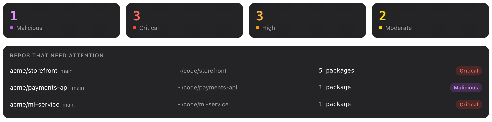
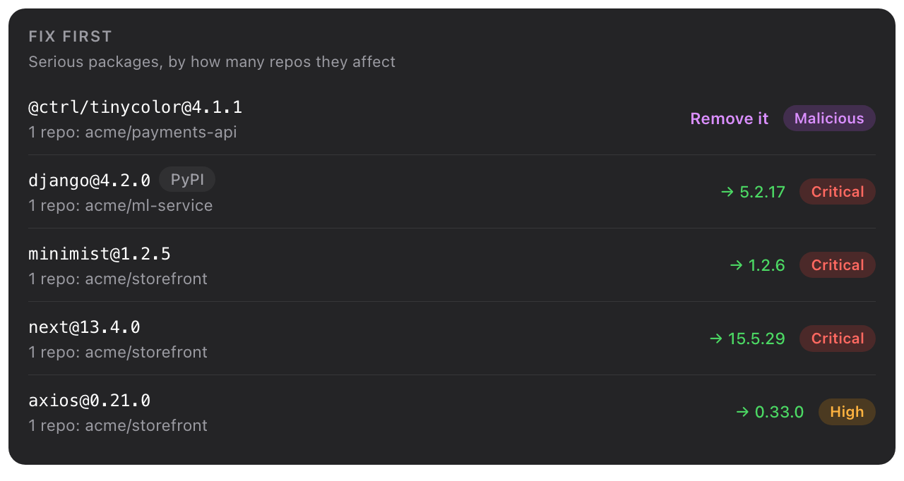
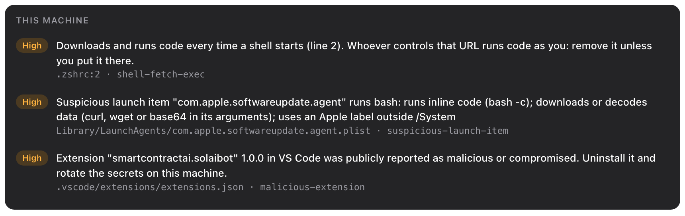

# selfguard

[](https://www.npmjs.com/package/selfguard)
[](https://github.com/josseed/selfguard/actions/workflows/ci.yml)
[](https://www.npmjs.com/package/selfguard#provenance)
[](LICENSE)
[](https://scorecard.dev/viewer/?uri=github.com/josseed/selfguard)
[](https://www.bestpractices.dev/projects/16958)
[](https://github.com/josseed/selfguard/actions/workflows/codeql.yml)

**A local-first guard for every repo on your machine, and for the machine itself.**

selfguard keeps watching every JavaScript, Python, Rust and Go project you have checked out, and
tells you when one of them is hit by a new vulnerability or a malicious package, even a repo you
haven't opened in months. It also flags what supply-chain attacks leave behind on a developer
machine: planted git hooks, malicious editor and browser extensions, launch agents, exposed dev
services and tokens in plain text.

<p align="center">
  
</p>

```sh
npm install -g selfguard && selfguard setup
```

Or get the **[Mac app](https://github.com/josseed/selfguard/releases/latest)**: menu bar, dashboard
and notifications, with everything bundled. Nothing to configure in a terminal.

## What it watches

| | What | Examples |
|---|---|---|
| 📦 | **Dependencies** of every repo, worktree and clone | `npm`, `pnpm`, `yarn`, `bun`, `uv`, Poetry, Cargo, Go modules, checked against [OSV.dev](https://osv.dev) and its malicious-packages feed |
| 🤖 | **CI and AI agents** | compromised or unpinned GitHub Actions, MCP servers in Claude, Cursor, VS Code, Codex and Gemini configs, repo settings that make an agent run code |
| 💻 | **This machine** | suspicious launch agents, `curl \| sh` in shell startup files, `.pth` startup hooks, git hooks and config that run code, malicious or sideloaded extensions (GlassWorm, hijacked Chrome extensions), DevTools, Ollama or Jupyter listening on the network, tokens in plain text |
| 🖥️ | **Your other machines** | other Macs over Tailscale, servers over SSH with a read-only reader |

<p align="center">
  
</p>

Each vulnerable package gets **one upgrade target**, not a wall of advisories, ranked by how
serious it is and how many repos it affects.

<p align="center">
  
</p>

Signs of an attack (a hook that downloads code, a known-malicious extension, a package from the
malicious feed) alert you right away, even on a fresh clone. Practices worth a look (a token in
plain text, an unpinned MCP server) wait quietly in the dashboard.

### Meet Bastion

<p align="center">
  
</p>

A 16-bit castle guard acts out what changed: he patrols when all is clear, sounds the horn for
a critical vulnerability, fights off a malicious package and celebrates your fixes. With the app
open, each alert arrives once, from him.

## Features

- **It tells you on its own.** A watcher re-checks a repo seconds after its lockfile changes, a
  scheduled sync catches new advisories, and a daily reminder lists what is still serious. You
  get a "✓ fixed" notification too.
- **Signal over noise.** Only checkouts with recent git activity alert you. Old clones stay
  listed but quiet (except for malicious packages), and the first scan is a silent baseline.
- **Hands-off.** `cd` into a project and it is registered and scanned. New clones in your code
  folders are picked up, and "Find my projects" searches your whole home folder.
- **Incident response.** `selfguard where <package>` answers "do I use this anywhere?".
- **AI-ready.** A built-in MCP server, `--json` on every command, and a guide for agents.
- **Safe by design.** It never runs code from your projects, has zero runtime dependencies, and
  only sends package names and versions over the network. Releases are signed and come with an
  SBOM you can [verify](docs/verify.md).

## Quick start

Requires **Node.js 20.10+**. Works on **macOS** and **Linux**. Native notifications and
scheduling are macOS-only for now.

```sh
npm install -g selfguard
selfguard setup
```

`setup` is a small terminal UI. Pick the folders where you keep your code, and selfguard scans
them. It then offers to install the shell hook and background watching with notifications.
You don't need the command line on a Mac: the selfguard app bundles everything, asks
whether to watch in the background, and can add a `selfguard` terminal command that runs its
engine (dashboard → Settings → This Mac → Terminal command).
The dashboard is only in the selfguard Mac app (from the
[latest release](https://github.com/josseed/selfguard/releases/latest)): open it from its menu
bar icon → Open Dashboard. In the terminal, `selfguard status` and `selfguard report` show the
same results.

```text
Where do you keep your code?
selfguard only looks inside the folders you pick, nothing else on your disk.

  [x] ~/code                          42 projects    depth 5
› [ ] ~/work                          17 projects    depth 5
  + add another folder…

↑/↓ move · space select · ←/→ depth · a add folder · enter continue · q quit
```

Then, from any terminal:

```text
$ selfguard status
 MALICIOUS  acme/payments-api  1 vulnerable pkg(s)  ~/code/payments-api
CRITICAL acme/storefront  6 vulnerable pkg(s) on main · 7 on feat/checkout  2 checkouts
   ├ main  6 vulnerable  ~/code/storefront
   └ feat/checkout worktree  7 vulnerable  ~/code/storefront-feat-checkout
CRITICAL acme/ml-service  2 vulnerable pkg(s)  ~/code/ml-service
✓        acme/docs-site  clean  ~/code/docs-site
```

Or scan a single project without setting anything up:

```text
$ selfguard scan
~/code/payments-api  412 packages
  3 vulnerable package(s), 9 advisories: 1 critical, 4 high, 4 moderate

  CRITICAL minimist@1.2.5 (transitive)
    → upgrade to 1.2.6 or later
    • GHSA-xvch-5gv4-984h critical Prototype Pollution in minimist

  HIGH axios@0.21.0 (direct)
    → upgrade to 0.33.0 or later
    • GHSA-cph5-m8f7-6c5x high axios Inefficient Regular Expression Complexity vulnerability
    …
```

## Documentation

| | |
|---|---|
| [Getting started](docs/getting-started.md) | Install, setup, dashboard, alerts, uninstall |
| [CLI reference](docs/cli.md) | Every command and flag, exit codes, environment variables |
| [Supported ecosystems](docs/multi-ecosystem.md) | JavaScript, Python, Rust and Go: files read, what is checked, limitations |
| [CI workflows and agent tools](docs/ci-and-agent-tools.md) | GitHub Actions in workflows and MCP servers of AI agents: what is read, checks, privacy |
| [This machine](docs/host.md) | Launch items, shell startup files, git and package manager config, plaintext credentials, Python startup hooks, editor and browser extensions, exposed local services: rules and privacy |
| [How it works](docs/how-it-works.md) | Discovery, lockfile parsing, repo grouping, OSV, caching, alerts |
| [AI and automation](docs/ai-and-automation.md) | MCP server setup, tools, JSON output, scripting and CI |
| [Security model](docs/security-model.md) | What selfguard trusts, what it sends, how it is released |
| [Verify your download](docs/verify.md) | Check the provenance of the npm package, the DMG and the SBOM yourself |
| [Troubleshooting](docs/troubleshooting.md) | Notifications, hook, scheduling, unsupported lockfiles |

## How it compares

| | selfguard | `npm audit` | osv-scanner | Dependabot |
|---|---|---|---|---|
| Watches every project on your machine | ✅ | ❌ one project, on demand | ❌ on demand | ❌ hosted repos only |
| Alerts when a new advisory hits an old project | ✅ | ❌ | ❌ | ✅ |
| Local-only (no repo hosting required) | ✅ | ✅ | ✅ | ❌ |
| npm, pnpm, yarn, bun | ✅ | npm only | ✅ | ✅ |
| uv, Poetry, Cargo, Go modules | ✅ | ❌ | ✅ | ✅ |
| Malicious package feed | ✅ via OSV | ❌ | ✅ via OSV | partial |
| Opens PRs with fixes | ❌ | ❌ (`npm audit fix` locally) | guided remediation | ✅ |
| Ecosystems | JavaScript, Python, Rust, Go | JavaScript | many | many |

selfguard complements these tools rather than replacing them. Keep Dependabot or Renovate for
automated fix PRs, and use selfguard to know what is vulnerable on your machine right now.

## Privacy

selfguard sends only the ecosystem, `name` and `version` of your locked dependencies to the OSV.dev API.
No file paths, repo names or source code ever leave your machine. All state lives in
`~/.selfguard`, readable only by your user. See the [security model](docs/security-model.md).

## Contributing

Bug reports, ideas and pull requests are welcome. See [CONTRIBUTING.md](CONTRIBUTING.md).
Please report security issues privately as described in [SECURITY.md](SECURITY.md).

## License

[MIT](LICENSE)
