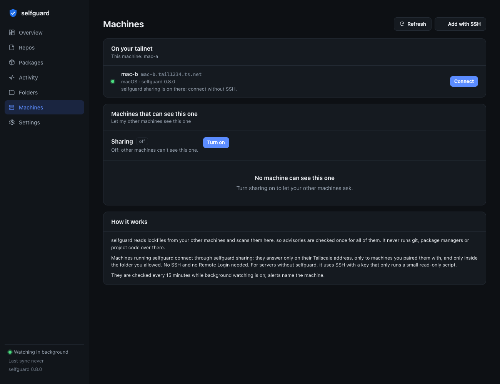
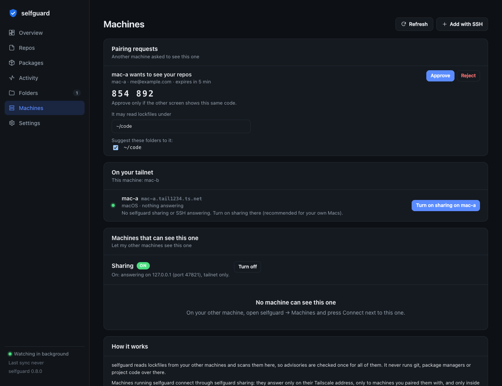

# Getting started

## Requirements

- **Node.js 20.10 or newer.** `node --version` to check.
- **macOS or Linux.** Everything works on both, except native notifications and the scheduled
  background sync, which are macOS-only for now. On Linux you can schedule `sync` with cron
  instead (see [below](#linux-schedule-with-cron)).
- **zsh** for the automatic shell hook (the default shell on macOS). Other shells can still use
  every command; only the automatic "register on `cd`" behavior needs zsh.

## Install

```sh
npm install -g selfguard
selfguard --version
```

selfguard has no runtime dependencies and no install scripts. You can check that the package
you installed was built by this repository's GitHub Actions and not tampered with:

```sh
npm audit signatures   # run inside any project that depends on selfguard
npm view selfguard dist.attestations
```

## Set up

```sh
selfguard setup
```

The setup wizard walks you through these steps:

1. **Choose your code folders.** selfguard suggests common locations that exist on your machine
   (`~/code`, `~/dev`, `~/projects`, `~/repository`, `~/Documents/GitHub`…) and counts the
   projects in each as you browse. Use <kbd>space</kbd> to select, <kbd>←</kbd>/<kbd>→</kbd> to
   change how deep it looks (default 5 levels, max 10), and <kbd>a</kbd> to add any other
   folder.
2. **Scan the projects it found.** This sends only package names and versions to OSV.dev and
   prints a summary of what is vulnerable.
3. **Install the shell hook.** It adds one line to `~/.zshrc` so projects are tracked when you
   `cd` into them.
4. **Enable background watching** (macOS). A lockfile watcher re-checks a repo seconds after its
   lockfile changes, a full sync runs every 6 hours, and a daily reminder sums up what is still
   open and serious.
5. **Point you to the Mac app** (macOS), which is the dashboard, if it isn't installed.

Each step asks first, and you can re-run `selfguard setup` at any time to change your folders.

### Non-interactive setup

For dotfiles, provisioning scripts or AI agents, the same can be done without the wizard:

```sh
selfguard roots add ~/code --depth 5   # watch a folder
selfguard discover                     # register and scan its projects
echo 'eval "$(selfguard init zsh)"' >> ~/.zshrc
selfguard schedule on --every 6h       # macOS
```

## Daily use

Once set up, you mostly don't have to do anything. selfguard notifies you when:

| What happened | Notification |
|---|---|
| A new advisory affects a repo you work on, or you install a vulnerable version | `selfguard: acme/web` · `2 vulnerable packages · worst: HIGH` · `axios → 1.20.0, …` |
| You fixed something (upgrade, `git pull` of a fix, merge) | `selfguard: acme/web ✓` · `17 vulnerable packages fixed` |
| Once a day (09:00–21:00), if serious issues are still open | `selfguard: 3 repos need attention` · `worst: CRITICAL` |
| A malicious package appears anywhere | A dialog that stays on screen, with remediation steps |

"Serious" means malicious packages, critical vulnerabilities outside dev dependencies, and high
ones in direct dependencies. Everything else is in the dashboard, not in your notifications.
Only **active** checkouts (git activity in the last 30 days) alert you; see
[how it works](how-it-works.md#alerts). Change the reminder with
`selfguard settings --remind weekly` (or `off`).

### Dashboard

```sh
selfguard ui
```

Opens the dashboard in the selfguard Mac app ([download](https://github.com/josseed/selfguard/releases/latest)).
It is the only visual part of selfguard: there is no web page and no server. On Linux use the
CLI (`selfguard status`, `report`). The dashboard shows:

- **Overview**: whether anything needs attention, counts by severity, and **Fix first**: the
  serious packages ranked by how many repos they affect.
- **Repos**: every repo with its worst severity, serious and vulnerable counts, checkouts and
  last activity, grouped by folder: the first folder under a watched folder (with
  `~/code` watched, `~/code/acme/api` and `~/code/acme/web` go under **acme**). Switch to
  **Flat** for a single list. A repo's page lists its vulnerable packages on the main checkout
  (or all checkouts) with the version that fixes each one, which branches have it and the
  advisories. Re-scan or ignore a checkout from there. **Copy markdown** copies the list as
  markdown (fix per package, how to refresh the lockfile without install scripts);
  `selfguard report <dir> --markdown` prints the same.
- **Packages**: vulnerable packages across all your repos, each installed version with its fix,
  and the repos that have it. "Upgrading `next` fixes 5 repos."
- **Activity**: what appeared, what got fixed and which reminders were sent.
- **Folders**: add folders to watch with a folder browser, change how deep to look, remove them,
  look for new projects, and include excluded paths again.
- **Machines**: dev servers watched over SSH: connection status, their folders (with the same
  folder browser), sync now, remove.
- **Settings**: reminder frequency, the active window, background watching on/off and
  updates.

Open it from the menu bar icon ("Open Dashboard"), from Spotlight (<kbd>⌘</kbd>+<kbd>Space</kbd>
→ "selfguard") or with `selfguard ui`.

### In the terminal

- **Entering a project** prints a one-line reminder if it has known vulnerabilities:
  ```text
  selfguard 3 vulnerable package(s) (1 critical, 4 high, 4 moderate) → selfguard scan
  ```
- **Installing or updating dependencies** changes the lockfile. selfguard notices on your next
  prompt and re-scans in the background.
- **New advisories** published for packages you already have are picked up by the scheduled
  sync. You get a notification naming the repo and the version to upgrade to.
- **Pulling a fix** (`git pull`, merging a dependency PR) is noticed by the lockfile watcher
  within seconds, even if you never open a terminal in that repo.

Useful commands:

```sh
selfguard ui                    # dashboard (Mac app)
selfguard remind                # what is serious and still open, right now
selfguard status                # active repos, riskiest first (--all for everything)
selfguard scan                  # full report for the current project
selfguard where @ctrl/tinycolor # "is this compromised package anywhere on my machine?"
selfguard vuln GHSA-35jh-r3h4-6jhm
```

See the [CLI reference](cli.md) for every command.

## If your code isn't in one folder

Click **Find my projects** on the dashboard's Folders page, or run:

```sh
selfguard discover --everywhere
```

selfguard searches your home folder and skips dependencies, build output, caches, hidden and
system folders, cloud drives and other disks. It then proposes a few folders to watch, with the
ones holding active repos already checked. On macOS, the first search may ask whether node can
access Desktop, Documents or Downloads; allow it to include projects there.

After that, a weekly background search starts watching new folders with active repos and tells
you ("now watching ~/Desktop/new-client"). Remove a folder and it isn't added back. Turn it off
in Settings or with `selfguard settings --auto-discover off`.

## Dev servers and other machines

### Your other Macs (selfguard on both, over Tailscale)

1. On the machine to watch, open selfguard → **Settings → Let my other machines see this one →
   Turn on** (or `selfguard share on`). It listens only on its Tailscale address.
2. On this machine, open **Machines**. Under "On your tailnet" it shows up with **Connect**.
3. Press Connect. Both screens show the same 6-digit code. Approve it on the other machine and
   choose which folder it may read.





No SSH, no Remote Login, nothing to paste. From the terminal: `selfguard machines add <name>`
(it picks sharing when the other machine answers), then `selfguard share approve <id>` over
there. Both machines need to be on your tailnet with the same Tailscale user.

### Servers without selfguard (SSH)

If you also code on servers (for example, agents working on a dev box on your tailnet), add them
with **Machines → Add with SSH** in the dashboard, or from the terminal:

```sh
selfguard machines peers                       # machines on your tailnet
selfguard machines add devbox.tail123.ts.net --scope ~/code --root ~/code
selfguard machines sync devbox
```

By default selfguard creates a key just for that machine and, using your SSH access once,
installs a small read-only *reader* there. The machine accepts that key only for the reader,
only inside `--scope`, and only from this Mac's tailnet address. Even if the key leaked, it
couldn't open a shell or read anything but lockfiles. See the
[security model](security-model.md#other-machines).

Requirements:

- `ssh <host>` works from this Mac without a password prompt, once, for the install. If it
  doesn't, `selfguard machines setup <name>` prints what to paste on the machine.
- The machine runs the regular `sshd` and has a POSIX `/bin/sh` (any Linux or macOS).
  Tailscale SSH ignores per-key restrictions; with it, use `--mode ssh`.

Their repos then show up everywhere, labeled with the machine: the Repos page (filter by
machine), alerts ("devbox · acme/api"), the daily reminder and **Copy markdown**. With
background watching on, they are checked every 15 minutes.

## Fixing what selfguard finds

For each vulnerable package selfguard tells you:

- **Direct or transitive.** A direct dependency is declared in your `package.json`
  (`pyproject.toml`, `Cargo.toml` or `go.mod` in other ecosystems). A transitive one is pulled
  in by another package.
- **`upgrade to X or later`.** The lowest version that fixes every advisory with a published fix.

Typical fixes:

- **Direct dependency:** bump it in `package.json` to at least the suggested version and
  reinstall.
- **Transitive dependency:** upgrade the direct dependency that pulls it in. If no compatible
  release exists, force the fixed version with your package manager's overrides:
  [npm `overrides`](https://docs.npmjs.com/cli/configuring-npm/package-json#overrides),
  [pnpm `overrides`](https://pnpm.io/package_json#pnpmoverrides) or
  [yarn `resolutions`](https://yarnpkg.com/configuration/manifest#resolutions).
- **Python, Rust, Go:** `uv lock --upgrade-package <name>` (or `override-dependencies` under
  `[tool.uv]`), `poetry update --lock <name>`, `cargo update -p <name> --precise <version>`, and
  `go get <module>@v<version> && go mod tidy`. Go versions are shown as OSV lists them, without
  the leading `v`.
- **Malicious package:** remove it immediately, reinstall from a clean state, and **rotate any
  credentials** the machine or CI could reach (npm tokens, cloud keys, SSH keys, `.env`
  secrets). Upgrading is not enough: the damage happens at install time.

After reinstalling, the lockfile watcher re-scans within seconds and confirms the fix with a
"✓ fixed" notification. You can also run `selfguard scan` to verify.

## Ignoring projects

Test fixtures, examples and archived repos often pin old versions on purpose. Stop tracking
them and keep them out of future discovery:

```sh
selfguard forget ~/code/shop/test/fixtures   # also hides everything below it
selfguard unexclude ~/code/shop/test/fixtures  # undo
```

Whole folders of old projects work the same way: `selfguard forget ~/code/old-clients`, or in the
dashboard open **Repos**, group **By folder** and press **Ignore folder** on that folder. Nothing
inside is tracked, scanned or alerted, until something there changes: when a project's lockfile,
`package.json` or git history is updated, that project comes back by itself (the others stay
paused). To bring it all back at once, use **Include again** under **Folders → Ignored folders**
(or **Machines** for another machine, where an ignored folder stays ignored for good); the
projects come back right away.

## Linux: schedule with cron

`selfguard schedule` uses launchd and is macOS-only. On Linux, add a cron entry instead
(`crontab -e`), using the absolute paths printed by `command -v node` and `command -v selfguard`:

```cron
0 */6 * * * /usr/bin/node /usr/local/bin/selfguard sync --background >> "$HOME/.selfguard/selfguard.log" 2>&1
```

Desktop notifications and the lockfile watcher are not implemented on Linux yet. New findings
are recorded and shown by `selfguard ui`, `selfguard status` and the shell hook.

## Staying up to date

selfguard checks npm once a day for a newer version, sending only the package name. When there
is one, you get one notification and the dashboard shows a banner with the release notes and the
command to run:

```sh
npm i -g selfguard@<version> --ignore-scripts
```

selfguard never updates itself. After you run that command, the dashboard shows **Restart
dashboard**, which reloads it with the new version at the same address. The background agents
pick up the new version on their next run. `selfguard update` checks right away. Turn the check
off with `selfguard settings --update-check off`.

## Uninstall

```sh
selfguard schedule off                 # macOS: remove the launchd agents
selfguard app uninstall                # macOS: remove ~/Applications/selfguard.app
npm uninstall -g selfguard
rm -rf ~/.selfguard                    # all local state
```

Then delete the `eval "$(selfguard init zsh)"` line (and the comment above it) from `~/.zshrc`.
If you registered the MCP server, remove it too (`claude mcp remove selfguard`).
